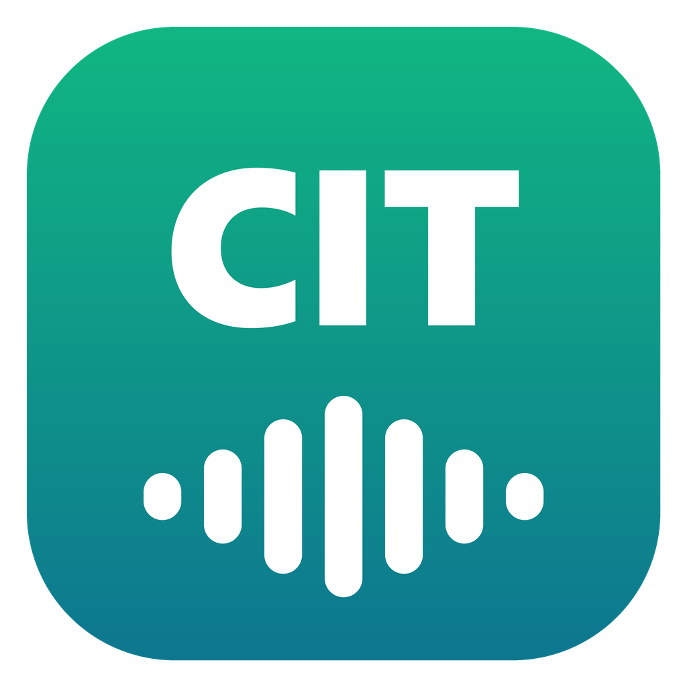
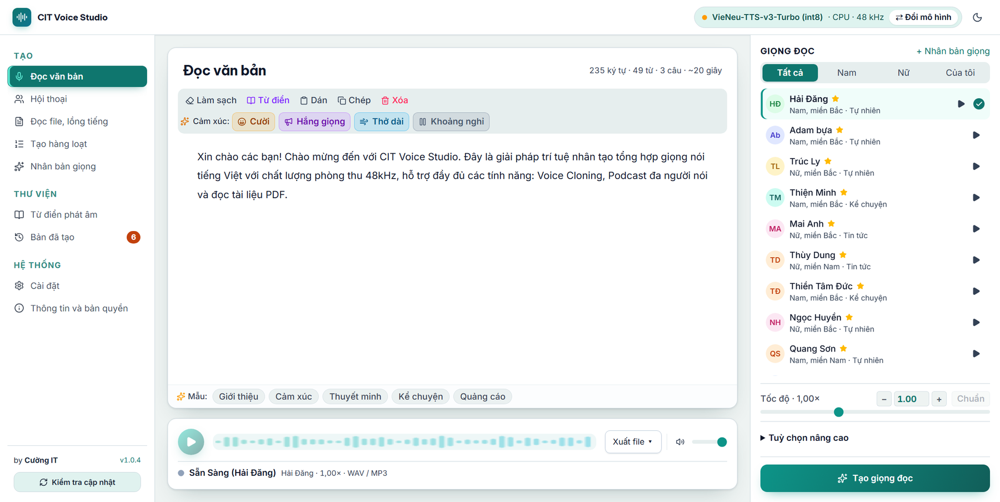

<div align="center">



# CIT Voice Studio

**Natural-sounding text-to-speech that runs entirely on your own computer: Vietnamese and 30+ other languages.**

No account · No Internet needed after install · Your text and voices never leave your machine

[](../../releases/latest)
[](../../releases)


[Tiếng Việt](README.md) · **English**

**[⬇ Download](#download)** &nbsp;·&nbsp; **[Features](#features)** &nbsp;·&nbsp; **[API](#api-for-other-apps)** &nbsp;·&nbsp; **[Troubleshooting](#troubleshooting)** &nbsp;·&nbsp; **[☕ Support](#support-the-project)**

💖 If you'd like to support Cường in developing it further, see **[cuongit.net/donate](https://cuongit.net/donate)**.

<br>

<picture>
  <source media="(prefers-color-scheme: dark)" srcset="assets/giao-dien-toi.png">
  
</picture>

</div>

<br>

> The app's interface is in Vietnamese. This page gives the Vietnamese menu names followed by an English translation, e.g. **Cài đặt** (Settings).

| 🎙️ **25 Vietnamese voices** | 🧬 **Voice cloning** | 🌍 **Foreign-language voices** |
|---|---|---|
| Male and female; Northern, Central and Southern accents; news, storytelling, audiobook styles… 48 kHz audio. | Record 3–8 seconds from your mic or import an MP3/WAV/M4A file to create your own voice. | Optional download: Supertonic 3 (31 languages, 10 voices) or Kokoro (41 native voices: English, French, Japanese, Chinese…). |
| 🎧 **Podcasts, dialogues** | 🎬 **Dubbing from subtitles** | 🔌 **API for other apps** |
| One voice per character, merged into a single audio file. | Drop in an `.srt` file and the speech lands exactly on the video's timestamps. | Call it from scripts, other software or AI agents at `http://127.0.0.1:8001`. |

### What's new in 1.0.6

- **Open source** under the Apache-2.0 license. Anyone can read the code, give feedback and contribute: see [CONTRIBUTING.md](CONTRIBUTING.md).
- **Native voices with Kokoro**: 41 voices in English, Spanish, French, Italian, Portuguese and Hindi, plus Japanese and Chinese. Download it from **Cài đặt → Mô hình** (Settings → Models).
- **Startup voice**: choose the voice that is selected when the app opens (**Cài đặt → Giọng đọc**, Settings → Voices).
- **Run as a server** on Linux, including with Docker: see [Running on a server](#running-on-a-headless-server).
- Fixes: installing over an older version no longer fails with "Không mở được server nội bộ" (cannot start the internal server); the "Ổn định" (stability) option is hidden for models that don't use it.

Full history: [Releases](../../releases).

---

## Download

**[⬇ Download page (Releases)](../../releases/latest)** - pick the file for your machine:

| Your machine | File | Size |
|---|---|---|
| Windows 10/11 64-bit | `CIT-Voice-Studio-v1.0.6-win-x86_64.exe` | ~367 MB |
| Linux 64-bit: Ubuntu, Debian, Linux Mint… | `CIT-Voice-Studio-v1.0.6-amd64.deb` | ~460 MB |
| Mac with Apple chip (M1, M2, M3…, arm64), macOS 14 or later | `CIT-Voice-Studio-v1.0.6-macos-arm64.dmg` | ~428 MB |
| Mac with Intel chip (x86_64), macOS 13 or later | `CIT-Voice-Studio-v1.0.6-macos-x86_64.dmg` | ~443 MB |

Every package ships with the voice model: it works right after install, with no Internet, and all data stays on your machine.

### System requirements

| | Minimum | Recommended |
|---|---|---|
| Operating system | Windows 10/11 64-bit, Ubuntu/Debian 64-bit, macOS 14 (Apple chip) or macOS 13 (Intel chip) | same |
| CPU | 4 cores | 6 cores or more |
| RAM | 8 GB | 16 GB or more |
| Free disk space | 3 GB | 5 GB |
| Graphics card | Not needed | NVIDIA card if you often generate long texts (see [Choosing a model](#choosing-a-model)) |

Measured speed: on an 8th-gen Intel Core i7 (4 cores), 10 minutes of audio takes about 5 minutes to generate.

**How much text per run?** No limit (since 1.0.1). The app writes audio to disk as it goes, so long texts don't use more RAM: a ~84,000-character text (~2 hours of audio) used about 1 GB of RAM. You only need time and disk space: one hour of WAV audio is about 330 MB. For texts several hours long, split them into chapters or use the **Tạo hàng loạt** (Batch) tab, so an interruption doesn't send you back to the start and each part is easy to fix.

### Windows

1. Download `CIT-Voice-Studio-v1.0.6-win-x86_64.exe`.
2. Double-click it and follow the steps. The installer does not need administrator rights.
3. Open the app from the Desktop shortcut or the Start Menu.

> **If a blue "Windows protected your PC" screen appears**, that is expected, not a virus: the installer is not code-signed yet, so Windows doesn't recognise it. Click **More info**, then **Run anyway**. Only do this for files downloaded from the official [Releases page](../../releases/latest). For other warnings, see [Troubleshooting](#troubleshooting).

**Uninstall:** Settings → Apps → CIT Voice Studio → Uninstall.

### Linux

Install the `.deb` package (Ubuntu, Debian, Linux Mint and other Debian-based distributions):

```bash
sudo apt install ./CIT-Voice-Studio-v1.0.6-amd64.deb
```

Open **CIT Voice Studio** from the application menu, or run `cit-voice-studio` in a terminal. Uninstall: `sudo apt remove cit-voice-studio`.

On Linux the app runs in a terminal window and opens its interface in your browser at `http://127.0.0.1:8001`. Keep the terminal open while you use it; close it or press `Ctrl+C` to quit.

### macOS

1. Open the `.dmg` and drag **CIT Voice Studio** into **Applications**.
2. On first launch macOS blocks it because the app is not notarized by Apple: go to **System Settings → Privacy & Security**, scroll to the bottom and click **Open Anyway**.
3. The app has its own window; quit with `Cmd+Q`.

Pick the file that matches your chip:  menu → **About This Mac**. If **Chip** says "Apple M…", download `arm64`; if **Processor** says "Intel", download `x86_64`.

The Linux and macOS packages include a detailed `HUONG-DAN.txt` guide (in Vietnamese).

---

## Features

### Speech generation
- **25 built-in voices**: male and female, Northern, Central and Southern accents, several styles (news, storytelling, audiobook, conversational…). The voice list shows gender, region and style.
- **Preview each voice** right in the list before choosing it.
- **English words inside Vietnamese text** are detected and read correctly.
- Reading speed from 0.75x to 1.50x.
- Export **WAV** or **MP3**; sample rate depends on the model: Turbo 48 kHz, Nano 24 kHz, Supertonic 44.1 kHz, Kokoro 24 kHz.

### Controlling the delivery
- **Emotion tags** inside a sentence: `[cười]` (laugh), `[thở dài]` (sigh), `[hắng giọng]` (clear throat).
- **Pause tags** for an exact silence: `[nghỉ 2s]`, `[nghỉ 500ms]` (`[pause 2s]` also works; up to 10 seconds each).
- **Pronunciation dictionary**: set how abbreviations or names the model gets wrong should be read, e.g. `KTX` → "ký túc xá", `SGK` → "sách giáo khoa". Open it with the **Từ điển** (Dictionary) button above the editor; it is saved and used for every run.
- **Import/export the dictionary as CSV** (opens in Excel, sample file included), with paging for long dictionaries.

### Foreign-language voices with Supertonic 3
- Download **Supertonic 3** (~400 MB) in **Cài đặt → Mô hình** (Settings → Models) to read **31 languages**: English, Japanese, Korean, French, German, Spanish, Russian, Arabic… (no Chinese) with 10 male and female voices.
- Choose the language of your text in **Ngôn ngữ văn bản** (Text language): English by default, or auto-detect. Voice previews read a sample sentence in that language. Works in every tab: TTS Studio, dialogue, batch, subtitle dubbing.
- Runs on CPU with nothing else to install, on Windows, Linux and macOS. For Vietnamese, VieNeu still sounds better; this model cannot clone voices.
- **The same 10 voices for all 31 languages** (5 female F1–F5, 5 male M1–M5). Character as described by Supertone:

| Voice | Character | Good for |
|---|---|---|
| F1 (female) | Calm, slightly low | Customer service, meditation |
| F2 (female) | Bright, playful | Social media, youth content |
| F3 (female) | Clear, announcer-like | News, announcements |
| F4 (female) | Crisp, confident | Corporate intros, training |
| F5 (female) | Gentle, soft | Audiobooks, encouragement |
| M1 (male) | Energetic, clear | Ads, announcements |
| M2 (male) | Deep, composed | Corporate, documentaries |
| M3 (male) | Polished, trustworthy | Presentations, speeches |
| M4 (male) | Light, friendly | Education, children |
| M5 (male) | Warm, smooth | Audiobooks, storytelling |

- **31 languages:** English, Vietnamese, Japanese, Korean, French, German, Spanish, Portuguese, Italian, Russian, Indonesian, Hindi, Arabic, Turkish, Dutch, Polish, Ukrainian, Swedish, Danish, Finnish, Greek, Czech, Slovak, Hungarian, Romanian, Bulgarian, Croatian, Slovenian, Estonian, Latvian, Lithuanian.
- **Quality:** about 99 million parameters, 44.1 kHz audio. According to Supertone, its accuracy (WER/CER) matches open models many times larger, with fewer repeated or skipped words than Supertonic 2. On a Core i7-8650U laptop English generates faster than real time; Vietnamese is no faster than VieNeu and is spoken about 2x slower, so keep VieNeu for Vietnamese. Supertone has stopped developing this model (the repository is archived), so there will be no updates.
- **Model-specific emotion tags**: `<laugh>`, `<breath>`, `<sigh>`, inserted from the emotion bar. Pause tags work as usual.
- The **pronunciation dictionary** works here too, handy for names and abbreviations, e.g. `CIT` → `C I T`, `km` → `kilometers`.

### Native voices with Kokoro (new in 1.0.6)
- Download **Kokoro** in **Cài đặt → Mô hình** (~350 MB; on first use the app also installs a ~22 MB phonemizer) to get **41 native voices**: English (US, UK), Spanish, French, Italian, Portuguese, Hindi. Japanese (~52 MB download, ~250 MB on disk) and Chinese (~25 MB) are added with a button under the Kokoro entry. 24 kHz audio.
- Each voice is a native speaker of one language; picking a voice switches **Ngôn ngữ văn bản** (Text language) to it. English has the best and most voices.
- **Does not read Vietnamese**, cannot clone voices, has no emotion tags; the pronunciation dictionary (written for Vietnamese) does not apply. Pause tags work as usual.
- With an NVIDIA card, choose **Kokoro (GPU NVIDIA)** for faster long texts (requires the GPU support install, like v3 Turbo GPU).
- Kokoro's phonemizer (partly GPL-licensed) is **not part of the installer**: your machine downloads it from PyPI when you click Download, into a separate `addons/` folder. Not available on macOS yet.

### Voice cloning
- Choose **Thu micro** (record about 3–8 seconds of natural speech, any content) or **Nhập file âm thanh** (import an MP3, WAV or M4A file) with one clear speaker and no background music. The app keeps at most 15 seconds from the first speech; Turbo uses at most 8 seconds of voiced audio.
- Only clone your own voice, or a voice whose owner allowed you to clone and use it. You must confirm your right to use it before saving; this is a declaration, not an identity check.
- Voices and declarations are stored on your machine and deleted together; nothing is sent to the author, and the original audio file is not copied.
- Save cloned voices to reuse them, and delete them when no longer needed.

### Dialogue / podcast
- Write a script with several characters, one voice each; the app merges it into one audio file.

### Reading files
- Extract text from **PDF, Word (.docx) and TXT**.
- Drop in an **.srt** subtitle file to dub along its timestamps (see below).
- **Làm sạch** (Clean up) removes extra spaces, bullets and line breaks in the middle of sentences, but keeps formulas such as `1 + 1`.

### Batch generation
- Put markers `[P1]`, `[P2]`… at the start of lines: each marker becomes **its own audio file**.
- Type directly or upload a TXT file. A sample file is included.
- Download files one by one, or all of them as a **.zip**.

### Subtitles for video
- Generate audio with an **.srt subtitle file**, timed sentence by sentence. Works directly in CapCut, Premiere, DaVinci Resolve…

### Dubbing from subtitles
Already have a subtitle file for your video (typed by hand, exported from CapCut/Premiere, or translated)? The app reads each line **at its timestamp** and produces one audio file to drop onto the video.

1. Open the **Đọc file** (Read file) tab and drop in the `.srt` (or `.vtt`). The app lists the lines with their timestamps.
2. Pick a voice (built-in or cloned) and a speed, then click **Lồng tiếng** (Dub).
3. Done: preview and download **WAV/MP3**. The audio is exactly as long as the video, every line on its timestamp. The result is saved in **Bản đã tạo** (History).

- A line longer than its slot is **read faster to fit** (up to 1.5x). If it still doesn't fit, it runs into the following silence or pushes the next line back slightly. **Words are never cut.**
- When lines get pushed back, the app also gives you an **adjusted subtitle file** so the on-screen text matches the speech.
- Formatting tags in subtitles (`<i>`, `{\an8}`…) are removed and the pronunciation dictionary is applied.
- Tip: if many lines are sped up or pushed back, lower the reading speed or shorten the lines.

### History
- Everything you generate is saved on your machine and **survives closing the app**: replay, re-download WAV/MP3/SRT, open the containing folder.
- Nothing is deleted automatically. The History tab shows the count and disk usage and reminds you to clean up when it grows large.

---

## Quick syntax

| Write in your text | Result |
|---|---|
| `Tin vui [cười] cho cả nhà.` | A laugh at that exact spot |
| `Phần một. [nghỉ 2s] Phần hai.` | Exactly 2 seconds of silence between the parts |
| `[P1]` … `[P2]` … | **Tạo hàng loạt** (Batch) tab: split into several files |

---

## Choosing a model

Change the model in **Cài đặt → Quản lý & Chọn Mô hình AI** (Settings → Manage & choose AI model). Models your machine cannot run are greyed out; hover to see why. The app remembers your choice and uses it next time (falling back to the default if that model was removed or fails).

| Your machine | Use | Notes |
|---|---|---|
| Regular PC, office laptop, **low-end machine** | **v3 Turbo INT8** (default) | Included in the installer. Fastest on CPU, 48 kHz audio |
| Machine with an **NVIDIA card** (Windows, Linux) | **v3 Turbo GPU NVIDIA** | Click **Cài hỗ trợ GPU** (Install GPU support) on that model |
| Want to try a small model | v3 Nano (experimental) | ~400 MB download, 24 kHz audio, weaker English |
| **Foreign-language** text with native voices | **Kokoro** | ~350 MB download; English, Spanish, French, Italian, Portuguese, Hindi, plus Japanese/Chinese. No Vietnamese; not on macOS yet |
| A language Kokoro doesn't have (Korean, German, Russian…) | **Supertonic 3** | ~400 MB download, 31 languages, 10 shared voices |

**Will it run on a weak machine?** Yes. It runs on the CPU and needs no graphics card. On an Intel Core i7-8650U laptop (2017, 4 cores) with the default model, one minute of speech takes about 30 seconds to generate. Newer machines are faster.

On a weak machine keep **Turbo INT8**. Nano is smaller but **not faster**: on that same laptop, Nano at default settings is almost twice as slow as Turbo INT8.

**NVIDIA cards:** there is no separate GPU installer. In the app, go to **Cài đặt → Quản lý & Chọn Mô hình AI** and click **Cài hỗ trợ GPU** on the GPU NVIDIA model. The app downloads PyTorch/CUDA once (a few GB, needs at least 12 GB free). An NVIDIA driver must already be installed (check with `nvidia-smi`). The gain is clearest on long texts. macOS runs on CPU only.

---

## API for other apps

While the app is open it runs an API server at `http://127.0.0.1:8001`. Other software, scripts or AI agents can call it to generate speech automatically.

| Method | Path | Purpose |
|---|---|---|
| `GET` | `/health` | Server status |
| `GET` | `/voices` | List of voices |
| `GET` `POST` | `/stream` | Real-time streaming speech |
| `POST` | `/api/tts/generate` | Text to WAV/MP3 |
| `POST` | `/api/tts/generate-with-subtitles` | Audio plus an .srt subtitle file |
| `POST` | `/api/tts/conversation` | Multi-speaker dialogue |

Emotion tags, pause tags and the pronunciation dictionary all work through the API.

The API uses built-in voices or saved cloned voices by `voice_id` from `/voices`. Create cloned voices in the app (mic or audio file, with the rights declaration), then use them through the API. There is no public cloning endpoint. Supertonic and Kokoro have built-in voices only.

Quick example (Python):

```python
import requests

r = requests.post(
    "http://127.0.0.1:8001/api/tts/generate",
    json={"text": "Xin chào từ phần mềm khác.", "voice_id": "Minh Đức"},
)
open("speech.wav", "wb").write(r.content)
```

**Full documentation:**
- `http://127.0.0.1:8001/docs`: try each endpoint in your browser.
- `http://127.0.0.1:8001/cit-voice-studio.md`: integration guide in Markdown (Vietnamese), ready to feed to Cursor, Claude, ChatGPT…
- `http://127.0.0.1:8001/openapi.json`: import into Postman.
- [docs/postman/CIT-Voice-Studio.postman_collection.json](docs/postman/CIT-Voice-Studio.postman_collection.json): a ready-made Postman collection; set the `baseUrl` and `apiKey` variables.

### Calling from other machines on your LAN

By default only software **on the same machine** can call the API, and no key is needed.

To allow other machines:
1. Open **Cài đặt → Cho máy khác truy cập API** (Settings → Allow other machines to access the API) and turn it on.
2. Click **Khởi động lại ngay** (Restart now). On first run Windows asks for firewall access: choose **Allow** for **Private** networks. On Linux with a firewall enabled, run `sudo ufw allow 8001/tcp`.
3. Copy the address (like `http://192.168.x.x:8001`) and the **API key** shown in Settings.
4. Other machines send the key in the `X-API-Key` header:

```bash
curl.exe -H "X-API-Key: <key>" http://192.168.1.5:8001/health
```

Other machines can only call the speech endpoints in the table above; they cannot see your history or settings. Click **Khoá mới** (New key) to revoke the old key immediately.

> ⚠️ Only enable this on a trusted network. The key travels over unencrypted HTTP. To expose it to the Internet, use an HTTPS tunnel (Cloudflare Tunnel, ngrok) instead of opening a port on your router.

### Running on a headless server

For a Linux machine that runs all day as a speech server for other machines. It runs from source, with no app window.

**1. Install** (Ubuntu 22.04/24.04, needs `git`; Node 20+ if you want the web interface):

```bash
curl -LsSf https://astral.sh/uv/install.sh | sh     # install uv, then reopen the terminal
git clone https://github.com/Cuongyd196/cit-voice-studio && cd cit-voice-studio
uv sync                                             # CPU
# uv sync --group gpu-app                           # or: NVIDIA card (driver ≥ 570, ~3.5 GB extra)
cd app-desktop/cit-voice-app && npm ci && npm run build && cd ../..   # web UI (skip if you only need the API)
```

**2. Test run:**

```bash
uv run vieneu-stream        # port 8001, Ctrl+C to stop
```

On first start the server downloads the VieNeu model (~312 MB, ~1 GB for GPU) into `models/hf_cache/` in the source folder. With an NVIDIA card it uses the GPU automatically. Change the port with `PORT` (e.g. `PORT=9000 uv run vieneu-stream`).

**3. Allow other machines to call the API.** By default the server only accepts requests from itself. Enable remote access by editing `~/CitVoiceStudio/remote-access.json` (start the server once in step 2 so the file and key are created):

```bash
python3 - <<'EOF'
import json, pathlib
p = pathlib.Path.home() / "CitVoiceStudio" / "remote-access.json"
d = json.loads(p.read_text()); d["enabled"] = True; p.write_text(json.dumps(d))
print("API key:", d["api_key"])
EOF
sudo ufw allow 8001/tcp     # if a firewall is enabled
```

Restart the server so it listens on all addresses (`0.0.0.0`), then call it as in [Calling from other machines on your LAN](#calling-from-other-machines-on-your-lan).

**4. Use the server's web interface.** Other machines can only call the speech API, not open the interface. To manage the server (download models, clone voices, view history, change the key), open an SSH tunnel from your machine and go to `http://127.0.0.1:8001`:

```bash
ssh -L 8001:127.0.0.1:8001 user@<server-ip>
```

Through the tunnel the server treats you as local, so no key is needed. The **Khởi động lại ngay** (Restart now) button in Settings does not work in this mode: after changing the port or remote access, restart from the command line (step 5).

**5. Start on boot** (systemd user service, no root needed):

```bash
mkdir -p ~/.config/systemd/user
cat > ~/.config/systemd/user/cit-voice-studio.service <<EOF
[Unit]
Description=CIT Voice Studio
After=network-online.target

[Service]
WorkingDirectory=$PWD
ExecStart=$(command -v uv) run --no-sync vieneu-stream
Restart=on-failure

[Install]
WantedBy=default.target
EOF
systemctl --user daemon-reload
systemctl --user enable --now cit-voice-studio
sudo loginctl enable-linger $USER          # run even when you are not logged in
journalctl --user -u cit-voice-studio -f   # view logs
```

Restart: `systemctl --user restart cit-voice-studio`. Update: `git pull`, run `uv sync` again (with the same group as in step 1) and `npm run build`, then restart.

To expose it to the Internet, put the server behind an HTTPS tunnel (Cloudflare Tunnel, Tailscale) instead of opening a router port; requests through a tunnel are always treated as remote, so the key is still required.

### Running with Docker

Replaces steps 1, 2 and 5 above. Requires Docker Engine on Linux with the compose plugin. The container uses the host network (`network_mode: host`) so the app can tell requests from the server itself apart from requests from other machines; it therefore does not work correctly on Docker Desktop for Windows/macOS.

```bash
git clone https://github.com/Cuongyd196/cit-voice-studio && cd cit-voice-studio
C="docker compose -f packaging/docker/compose.yaml"
$C up -d --build            # first build takes a few minutes
$C logs -f                  # wait for "Sẵn sàng" (ready)
```

**With an NVIDIA card:** install driver ≥ 570 and the [NVIDIA Container Toolkit](https://docs.nvidia.com/datacenter/cloud-native/container-toolkit/latest/install-guide.html), check with `docker run --rm --gpus all ubuntu nvidia-smi`, then add the GPU file:

```bash
C="docker compose -f packaging/docker/compose.yaml -f packaging/docker/compose.gpu.yaml"
$C up -d --build            # the GPU image is ~3.5 GB larger
```

- The image contains no models. On first run the app downloads them into the `cit-data` volume (`/data`). That volume also keeps history, settings, the API key, the dictionary and cloned voices, so rebuilding or removing the container loses nothing.
- The container restarts on boot (`restart: unless-stopped`); no systemd needed.
- Web interface: on the server itself open `http://127.0.0.1:8001`, or from another machine through an SSH tunnel as in step 4. Accept the terms of use in the interface on first open.
- Change the port: uncomment the `PORT` line in `packaging/docker/compose.yaml`.

Allow other machines to call the API (replaces step 3), then restart:

```bash
$C exec app python -c "
import json, pathlib
p = pathlib.Path('/data/CitVoiceStudio/remote-access.json')
d = json.loads(p.read_text()); d['enabled'] = True; p.write_text(json.dumps(d))
print('API key:', d['api_key'])"
$C restart
```

Common commands:

```bash
$C ps                           # status, including the health check
$C restart                      # restart (instead of the button in Settings)
git pull && $C up -d --build    # update
$C down                         # stop; adding -v ALSO DELETES the data in the volume
```

---

## Where your data is stored

Everything stays on your machine:

| OS | Folder |
|---|---|
| Windows | `%LOCALAPPDATA%\CitVoiceStudio\` |
| Linux | `~/CitVoiceStudio/` |
| macOS | `~/Library/Application Support/CIT Voice Studio/` |

Inside it:

| Folder / file | Contents |
|---|---|
| `history\` | Generated audio and subtitles |
| `pronunciation-dict.json` | Pronunciation dictionary |
| `remote-access.json` | Remote access settings and API key |
| `server-settings.json` | Server port |
| `ui-prefs.json` | Light/dark theme, auto-play, playback speed |
| `save-settings.json` | Save folder, open after saving |

On Windows, models and cloned voices live in the `models` folder next to the app; Kokoro's phonemizer and GPU support (if installed) live in `addons` and `gpu_venv`, also next to the app, and are removed on uninstall. Linux and macOS keep them in the data folder above. Updating to a new version keeps your data.

---

## Troubleshooting

**Windows refuses to open the app**
The installer is not code-signed, so Windows may warn you. Depending on the message:

- *"Windows protected your PC"* (blue SmartScreen screen): click **More info** → **Run anyway**.
- File marked as downloaded from the Internet: right-click the `.exe` → Properties → tick **Unblock** → OK.
- *"Smart App Control blocked an app that may be unsafe"* (Windows 11): Smart App Control blocks every unsigned app and **has no per-app exception**, so Unblock or Run anyway won't help. The only way is to turn it off: **Windows Security → App & browser control → Smart App Control settings → Off**.
  > ⚠️ Turning off Smart App Control removes a layer of Windows protection, and on many Windows builds it **cannot be turned back on** without reinstalling Windows. Only do this if you trust the source (the official Releases page of this repository). Otherwise, install on another machine.

**macOS: "cannot be opened because the developer cannot be verified"**
Go to **System Settings → Privacy & Security** and click **Open Anyway**. Or run in Terminal:

```bash
xattr -dr com.apple.quarantine "/Applications/CIT Voice Studio.app"
```

**macOS: the app does not open on an older Mac**
It needs macOS 14 Sonoma or later (macOS 13 for the Intel build).

**Linux: the interface does not open by itself**
Open a browser at `http://127.0.0.1:8001`. Keep the app's terminal window open.

**Windows: the app opens in a browser instead of its own window**
Not a bug; everything still works. The machine lacks **Microsoft Edge WebView2 Runtime**, so the app falls back to the browser. For a separate window, install WebView2 Runtime (free, from Microsoft):
<https://go.microsoft.com/fwlink/p/?LinkId=2124703>

Windows 11 has it built in. Windows 10 usually has it if a recent Edge is installed; LTSC editions or fresh installs often don't.

**Choosing the FP32 model shows an error**
The installer includes only the INT8 model. FP32 needs an extra ~453 MB download, so the first selection requires Internet.

**A model is greyed out**
Your machine cannot run that model. Hover over it to see why.

**Downloading Kokoro fails**
On first use the app downloads the model from Hugging Face and the phonemizer from PyPI, so it needs Internet access to both (company networks or proxies may block them). Antivirus software sometimes locks freshly downloaded files: click Download again; finished parts are not downloaded twice.

**Port 8001 is already in use**
Quit the app completely and reopen it. If it still fails, change the port in **Cài đặt → Cổng server** (Settings → Server port), or restart the computer.

**Other machines cannot call the API**
- Connection refused: check that **Cho máy khác truy cập API** is on, the app was restarted, and the Windows firewall allows the app.
- `401`: missing or wrong key.
- `403`: the feature is turned off.
- `404`: the path is not one of the public API endpoints.

**An abbreviation is read wrong**
Add it to the **Từ điển** (Dictionary) with the reading you want, e.g. `KTX` → `ký túc xá`.

---

## Related video projects

- Create videos comparing two concepts: 🔗 [github.com/Cuongyd196/auto-compare-video](https://github.com/Cuongyd196/auto-compare-video)
- Create a video from a link or article: 🔗 [github.com/Cuongyd196/auto-video-gen](https://github.com/Cuongyd196/auto-video-gen)
- Create a video from a topic with Remotion: 🔗 [github.com/Cuongyd196/remotion-cuongit-template](https://github.com/Cuongyd196/remotion-cuongit-template)
- Create hand-drawn whiteboard videos from a topic, script or SRT file: 🔗 [github.com/Cuongyd196/whiteboard-video](https://github.com/Cuongyd196/whiteboard-video)
- Sample videos made with these tools:
  - 📹 Facebook: [www.facebook.com/cuongit96/reels/](https://www.facebook.com/cuongit96/reels/)
  - 📹 TikTok: [www.tiktok.com/@cuongit96](https://www.tiktok.com/@cuongit96)

**Chat about making videos with AI** (Vietnamese): [Facebook group](https://www.facebook.com/groups/1010029065373486/) · [Zalo group](https://zalo.me/g/8bfeotyh5ewtkzxmp5gt)

---

## Credits

CIT Voice Studio is developed by **Cường IT**. It uses three third-party speech models:

- **VieNeu-TTS** by **Phạm Nguyễn Ngọc Bảo** - Vietnamese voices and voice cloning; included in the installer. This is the foundation of CIT Voice Studio.
- **Supertonic 3** by **Supertone Inc.** - foreign voices in 31 languages; downloaded only if you choose it.
- **Kokoro-82M** by **hexgrad** - native voices in 8 languages; downloaded only if you choose it.

The speech models belong to their authors. Cường IT's part is the application: the interface, additional features and the installers for Windows, Linux and macOS.

Many thanks to Phạm Nguyễn Ngọc Bảo for building and sharing VieNeu-TTS, to Supertone for releasing Supertonic, and to hexgrad for releasing Kokoro.

| | |
|---|---|
| VieNeu-TTS (source) | [pnnbao97/VieNeu-TTS](https://github.com/pnnbao97/VieNeu-TTS) |
| VieNeu-TTS on Hugging Face | [pnnbao-ump/VieNeu-TTS](https://huggingface.co/pnnbao-ump/VieNeu-TTS) |
| Supertonic (source) | [supertone-oss-archive/supertonic](https://github.com/supertone-oss-archive/supertonic) |
| Supertonic 3 on Hugging Face | [supertone-oss-archive/supertonic-3](https://huggingface.co/supertone-oss-archive/supertonic-3) |
| Kokoro (source) | [hexgrad/kokoro](https://github.com/hexgrad/kokoro) |
| Kokoro-82M on Hugging Face | [hexgrad/Kokoro-82M](https://huggingface.co/hexgrad/Kokoro-82M) |
| Author of this app | [me.cuongit.net](https://me.cuongit.net) |

---

## Responsible use

- **Only clone your own voice or a voice you have permission to use.** You must have the right to use the recording and use the voice only within the scope agreed; the app does not verify identity or voice ownership.
- **Do not impersonate others** (family members, celebrities, officials, organisations, businesses…) to defraud, borrow money, defame, insult or mislead.
- **Respect copyright:** the text you read (books, stories, articles) must be yours or used with permission.
- When publishing content that imitates a real person's voice, **clearly label it as AI-generated**.

On first launch you must accept the [Terms of use](DIEU-KHOAN.md) (Vietnamese). Users are legally responsible for the content they create. The authors of CIT Voice Studio, VieNeu-TTS, Supertone and Kokoro are not responsible for misuse.

CIT Voice Studio is an independent application, **not an official product of VieNeu-TTS, Supertone or Kokoro**.

---

## Support the project

CIT Voice Studio is and will stay free. If you find it useful and want to help the author keep going (entirely optional):

| How | Link |
|---|---|
| 💖 All options | [cuongit.net/donate](https://cuongit.net/donate) |
| ☕ Visa / PayPal | [buymeacoffee.com/cuongit96](https://buymeacoffee.com/cuongit96) |
| 🏦 Vietnamese bank transfer (QR code) | [View QR code](https://buymeacoffee.com/cuongit96/gallery/5234541) |
| 💖 GitHub Sponsors | [github.com/sponsors/Cuongyd196](https://github.com/sponsors/Cuongyd196) |

Feedback, bug reports and sharing the app with people who need it help a lot too. Thank you!

---

## License

Apache License 2.0 - © Cường IT, based on VieNeu-TTS © Phạm Nguyễn Ngọc Bảo.

The Supertonic 3 model © Supertone Inc. is licensed under **OpenRAIL-M**: commercial use is allowed, but impersonating others without consent, fraud, harmful misinformation and publishing AI-generated content without disclosure are prohibited (see [THIRD-PARTY-NOTICES.md](THIRD-PARTY-NOTICES.md)). The model is not in the installer; its license file is downloaded with it. Supertone's original licenses:

- Model: [OpenRAIL-M](https://huggingface.co/supertone-oss-archive/supertonic-3/blob/main/LICENSE)
- Sample code (partly reused to run the model): [MIT](https://github.com/supertone-oss-archive/supertonic/blob/main/LICENSE)

The Kokoro-82M model © hexgrad is licensed under [Apache-2.0](https://huggingface.co/hexgrad/Kokoro-82M); the GPU runner code is copied from hexgrad/kokoro (Apache-2.0). Kokoro's phonemizer is partly **GPL-3.0** (phonemizer, espeak-ng): it is not in the installer; your machine downloads it from PyPI when you click Download.

- Free for personal and commercial use (video voice-overs, content creation, teaching…).
- Open source under Apache-2.0. To change the code or give feedback, see [CONTRIBUTING.md](CONTRIBUTING.md).
- Licenses of bundled libraries: [THIRD-PARTY-NOTICES.md](THIRD-PARTY-NOTICES.md). Privacy: [PRIVACY.md](PRIVACY.md) - the app collects no data.
- The audio you create is yours. You are responsible for its content (see [Responsible use](#responsible-use)).
